# Fork changes (on top of v3.2.1)

Changes made on a GL-E5800 (Mudi 7) and tested live on the device, on firmware 4.10.3 and 4.10.4. The upstream project is [robavionix/gl-e5800-dashboard](https://github.com/robavionix/gl-e5800-dashboard) (MIT). Every screenshot is rendered by the dashboard itself, with demo data where real data would be private.

Install exactly as upstream: `./install.sh [router-ip]`. It now also copies the Arabic font and installs `zoneinfo-africa`.

---

## 1. Arabic (RTL) SMS rendering

**Problem.** Arabic SMS showed as empty boxes (tofu) in the inbox, the message view and the Home tile. Two separate causes:
- None of the bundled screen fonts in `/etc/gl_screen/language/ttf/` has a single Arabic glyph. `default_cn_medium` included, every Arabic code point renders as `.notdef`.
- The device's Pillow (9.5.0) is built **without libraqm**, so even with a font it can neither join Arabic letters nor lay them out right-to-left.

Your UCS2 decoding in `_parse_sms_file` was already correct. Only the rendering was missing.

**Fix.** It is pure Python, with no new packages and no compiled dependencies:
- `ar_shape()` does contextual shaping into Unicode Presentation Forms-B: isolated, final, initial and medial forms, plus lam-alef ligatures. It also covers the Persian letters پ چ ژ ک گ ی. Diacritics are dropped, since they can't be positioned without a shaping engine.
- `_bidi_visual()` is a small bidi reorder:
  - Arabic runs are reversed.
  - Latin and number runs stay left-to-right.
  - Neutrals are resolved from their neighbours, and paragraph direction comes from the first strong character.
  - Brackets are mirrored.
  - Number-like tokens stay in one piece: `*123#`, `+974…`, `50%`, `11:59`.
- Drawing goes in runs on one shared baseline. Arabic glyphs come from a bundled **Noto Sans Arabic Medium** (OFL, about 250 KB) at `/root/dashboard/fonts/`, and everything else uses the usual GL font.
- `sms_wrap()` and `sms_truncate()` are cached and handle word-wrap and ellipsis. RTL lines hug the right margin.
- Text without Arabic takes exactly the old code path.

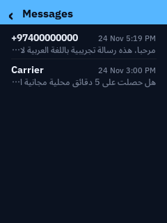 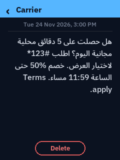

## 2. SMS inbox fixes

- **Messages missing from the inbox.** GL's SMS manager moves handled messages to `/etc/spool/sms/storage/`. The web UI showed 2 messages while the dashboard showed 1. `storage` is now added to `SMS_SPOOL_DIRS`.
- **Phantom "Unknown" entry with an empty body.** This was smstools' `GMS1-concatenated`, the raw PDU parts of a multipart SMS still being assembled. Files ending in `-concatenated`, or with no `From:` header, are now skipped.
- **Delete button** at the bottom of the message view, behind the existing confirm dialog (`confirm_action = "sms_delete"`). It unlinks the spool file, only for paths inside `SMS_SPOOL_DIRS`. The GL web UI reads the same spool, so the message disappears there too.
- **Message view auto-fits:** the font steps down from 15 to 11 px until the whole message fits above the button, since that screen has no scrolling.
- **Home tile** now shows the message count only ("2 messages"), not the sender and text. That was my preference, for privacy on a screen that's always visible.

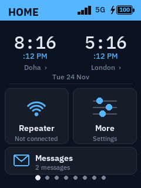 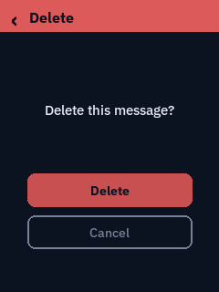

## 3. Prayer times page (new page, 8th dot)

- **Local calculation, no internet needed.** It uses the standard astronomical method (as on praytimes.org): sun declination and equation of time, Fajr and Isha from a twilight angle or a fixed number of minutes after Maghrib, Asr from the shadow factor. At high latitudes it falls back to an angle-based share of the night (London and Zurich in summer).
- **Manual location picker.** Tap the city, choose the country, then the city. There are 33 countries, and each country uses its official method:
  - Qatar, Umm al-Qura, UAE, Kuwait, Egypt, Jordan, Turkey, Morocco
  - MWL, ISNA, Karachi (Hanafi Asr), SE Asia
- **Matches the official timetable for Qatar.** `PRAYER_ADJUST` adds precautionary rounding (never early for Dhuhr through Isha), Fajr −1 and Maghrib +2. Verified minute-for-minute against the Qatar Awqaf app for Doha.
- **Hijri date.** It uses the tabular (civil) calendar. Since Qatar follows moon sighting, `hijri_offset` (default +1) corrects it, and tapping the date cycles it from −2 to +2.
- **Countdown** to the next prayer, and the next prayer is highlighted.
- **Prayer alert:**
  - When a prayer time arrives, the dashboard turns the backlight on if the screen is asleep.
  - It shows a full-screen alert for 60 s or until tapped.
  - If it woke the screen itself and nobody touched it, the screen goes back to sleep afterwards.
  - It has an Alert ON/OFF pill on the page.
  - It won't fire twice for the same prayer, including across a dashboard restart.

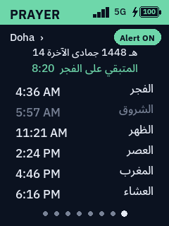 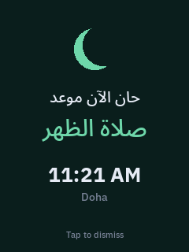 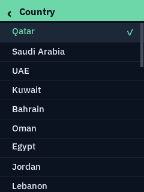 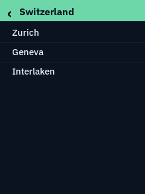 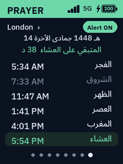

## 4. 12-hour clock

There are new `hm12()` and `ampm()` helpers. Home clocks show `8:16` with `:12 PM` under them, and the prayer times, the alert and the SMS timestamps all use 12-hour time.

## 5. Tailscale page (replaces OpenClash in `PANEL_NAMES`)

OpenClash isn't installed on my unit, so that page was dead. The Tailscale page does all four steps the GL web UI needs for a working exit node, through GL's own Lua RPC (`tailscale.set_config`):

1. Enable Tailscale
2. Custom Exit Node
3. The selected exit node
4. IP Masquerading

A checklist shows each step live. An exit-node picker lists the online peers that offer exit, and remembers them in config. "Off" sends the same cleared values the web UI does.

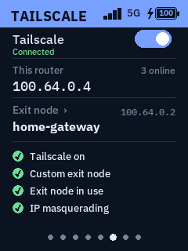 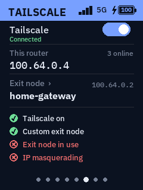 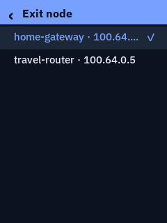

**Bug found on the way: no internet after enabling an exit node, on a self-hosted control server (Headscale with embedded DERP).**
- On the E5800, `/etc/resolv.conf` points at the **carrier's DNS**, not dnsmasq.
- Once the `0.0.0.0/0` exit route comes up, tailscaled's lookup of the control/DERP hostname goes into a tunnel that isn't working yet. It's a race, and it often lost.
- Fix: before enabling, the dashboard resolves the login-server host via `nslookup <host> 1.1.1.1` and pins its public IPv4 in `/etc/hosts` with a tag comment. Go's resolver reads `/etc/hosts` first. It's undone with `sed -i "/ts-derp-pin/d" /etc/hosts`.
- After this, enabling from the screen worked every time.

## 6. Services page (replaces Games)

It has four cards, each with a toggle that's verified against the real state, via GL's RPC modules:

| Card | What it does |
|---|---|
| AdGuard Home | `adguardhome set_config {enabled, dns_enabled}` |
| WireGuard | Uses your existing AutoVPN functions. Tapping the left side picks the peer |
| ZeroTier | Only flips `enabled`, and passes `id`/`lan`/`wan` back unchanged |
| Tor | `tor set_config {enable}`, with bootstrap % from `get_status` |

WireGuard and Tor both route all traffic, so their confirm dialog warns when a Tailscale exit node is also active.

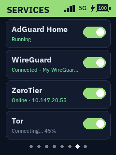

## 7. Small things

- **QAR** has been added to `CURRENCIES` and `CURRENCY_NAMES` (for USD→QAR and GBP→QAR).
- `draw_page_dots()` now defaults to `len(PANEL_NAMES)` instead of a hard-coded 7, so adding a page doesn't break the dots.

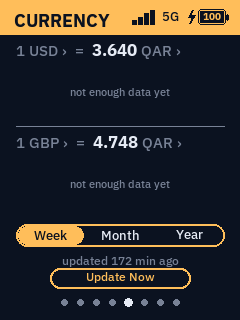

## 8. Power page (new page, 9th dot) and power-button hold

- A last page with one big power button. Tapping it opens a menu: **Shut down**, **Reboot**, **Exit dashboard** (back to the stock UI), **Cancel**.
- Holding the hardware power button (~1 s) used to offer only "exit dashboard?", so the device could not be powered off from the button while the dashboard was running. The hold now opens the same menu.
- `toggle.sh off` is now temporary: it stops the dashboard and starts the stock UI without changing what starts at boot, so the dashboard always comes back after a reboot. `toggle.sh on` still makes it the boot default.

## 9. Network mode on the Active SIM page (replaces the WireGuard tile)

WireGuard already lives on the Services page, so its tile on the SIM page became a three-way **Auto / 5G only / 4G only** switch. It uses the RPC of the [MudiModem](https://remotetohome.io) app (`/usr/lib/oui-httpd/rpc/mudimodem`), which must be installed:

1. `set_bands {mode}`: MudiModem arms its own 60 s revert watchdog.
2. The dashboard pings 8.8.8.8 for up to 45 s.
3. If the internet is back it calls `confirm`, otherwise `revert_now`, so a mode with no coverage can never strand the device offline.

Without MudiModem no mode is highlighted and a tap just reports that the switch failed; nothing on the modem changes.

## 10. After a GL firmware upgrade

GL's A/B upgrade keeps only paths listed in `/lib/upgrade/keep.d`. `/root` and opkg packages are wiped, so after an upgrade run `./install.sh` again and `toggle.sh on`. Copy `/root/dashboard/config.json` off the device first to keep your settings.

## 11. Observation, not changed

The `cell` poll (5 s) and the `sms` poll (15 s) both end up talking to the modem. Together with MudiModem polling too, I saw AT-command contention. Something like 30 s and 60 s might be a kinder default. I haven't changed it, so I'm only mentioning it.

---

Thanks to robavionix for the dashboard!
